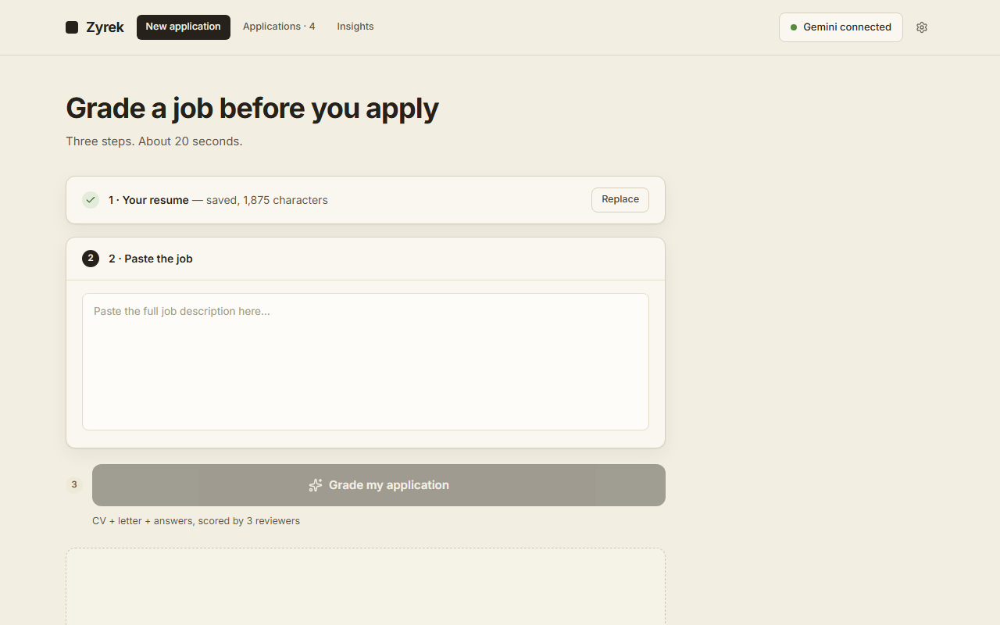
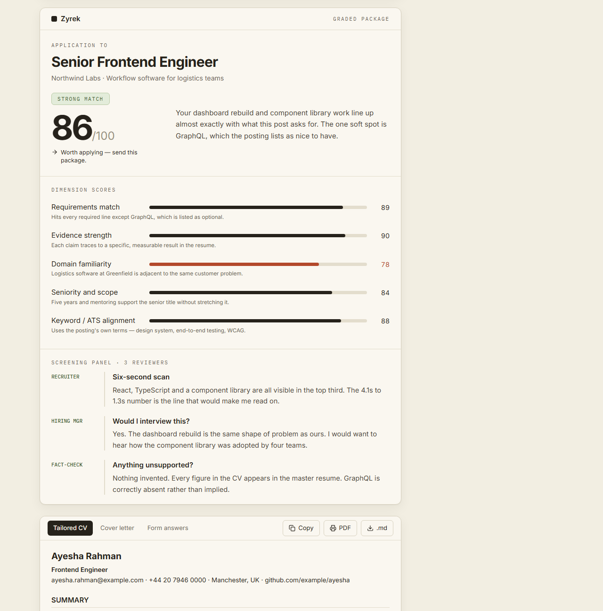
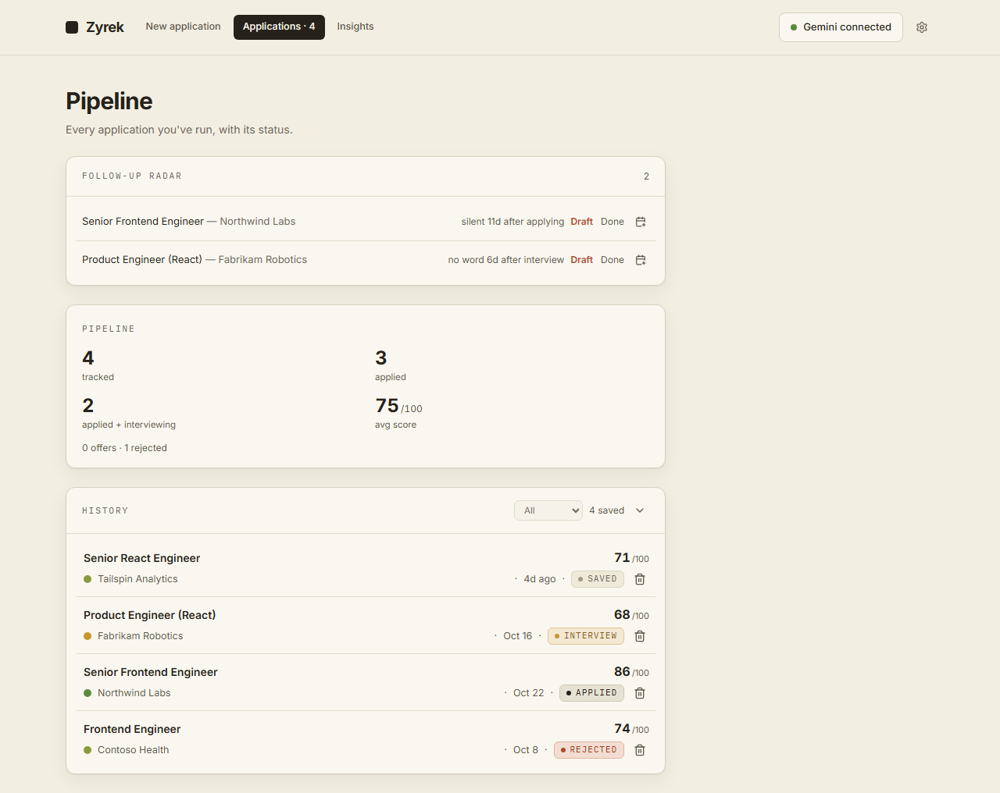
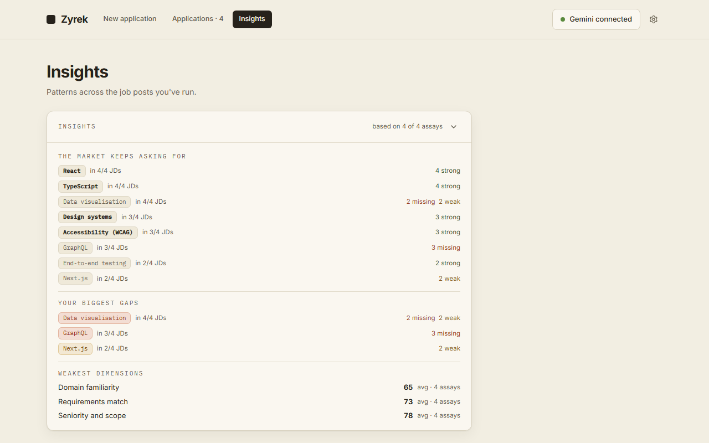

# Zyrek

*The honest examiner. It reads the job, reads you, and tells you the truth before you hit apply.*

**Live:** https://zyrek-zn84.vercel.app/

Paste a job description, and Zyrek returns a complete application package — a tailored CV, a cover letter, and answers to the screening questions you are most likely to face — then grades it the way a real hiring team would. It runs entirely in your browser with your own AI key. There is no backend and no account.

> The screenshots below show fictional sample data: an invented candidate, invented companies, and `example.com` contacts. None of it is real.



*Three steps. Save your master resume once, paste any job post, run it.*



*One call returns the score, the reviewer panel, and the full package — tailored CV, cover letter, form answers.*



*Every run becomes a tracked application, with a radar that flags the ones gone quiet.*



*Across everything you have run: what the market keeps asking for, and where your evidence keeps coming up short.*

## What it does

**Grading**

- A score out of 100 across five dimensions — requirements match, evidence strength, domain familiarity, seniority and scope, keyword/ATS alignment — each with a one-line justification.
- A three-reviewer panel on every run: a recruiter's six-second scan, a hiring manager's interview decision, and a fact-checker's verdict on anything unsupported.
- A code-level integrity check cross-references the generated CV against your real resume and flags any skill that slipped in without evidence. Gaps stay gaps.

**The package**

- A tailored CV that keeps your own structure and your contact details exactly as you wrote them — reordered and reworded toward the job, never invented.
- A cover letter framed for international applications: candidate header, day-first date, recipient block, greeting, and sign-off, applied at display time so it fits letters written earlier too. Not happy with it? **Rewrite** runs a second pass on the letter alone.
- Answers to the three screening questions this role is most likely to ask, drawn from your resume's evidence.
- Export the CV or the letter as a clean PDF through your browser's print dialog — no browser date, URL, or page-number stamps in the output.

**After you apply**

- A pipeline tracker: Saved → Applied → Interview → Offer / Rejected, with private notes and a contact per application.
- A follow-up radar that flags applications gone silent — 7 days after applying, 5 after an interview — drafts the polite nudge with your own key, and exports a reminder as an `.ics` file.
- Interview prep packs built from any saved run: the questions this exact job makes likely, including probes at your weak spots, with honest answers and a flashcard practice mode.
- Insights across every saved run: the skills the market keeps demanding, your repeating evidence gaps, and your weakest dimensions.
- Re-run any old job post against your current resume and see which scores moved.

**Setup and data**

- Four providers — Gemini, Groq, OpenAI, Claude — each with its own saved key and an optional per-provider model override. With more than one key saved, a rate-limited run fails over to the next provider automatically.
- Backup and restore everything — history, notes, prep packs, keys, resume — as a single JSON file.
- 100% client-side. Your resume and keys live in this browser's localStorage and nowhere else; the only network call is the one your own key makes to your chosen provider.

## Anti-fabrication

The system prompt forbids inventing experience, metrics, employers, or skills. Content may only be reframed, reordered, and emphasized from what is already in your resume. The fact-check reviewer names anything softened or stretched, and the integrity check catches claims the model let through. A missing skill is reported as missing.

## Run locally

```sh
cd zyrek
npm install
npm run dev
```

Then add an API key from Settings — Gemini and Groq have free tiers; OpenAI and Claude are paid per use.

To regenerate the screenshots above after a UI change:

```sh
cd zyrek
node scripts/take-readme-screenshots.mjs
```

## Roadmap

- [x] Application tracker (statuses, notes, stats)
- [x] Gap intelligence across saved runs
- [x] Resume version diffing
- [x] Interview prep from any saved run
- [ ] Test suite + CI
